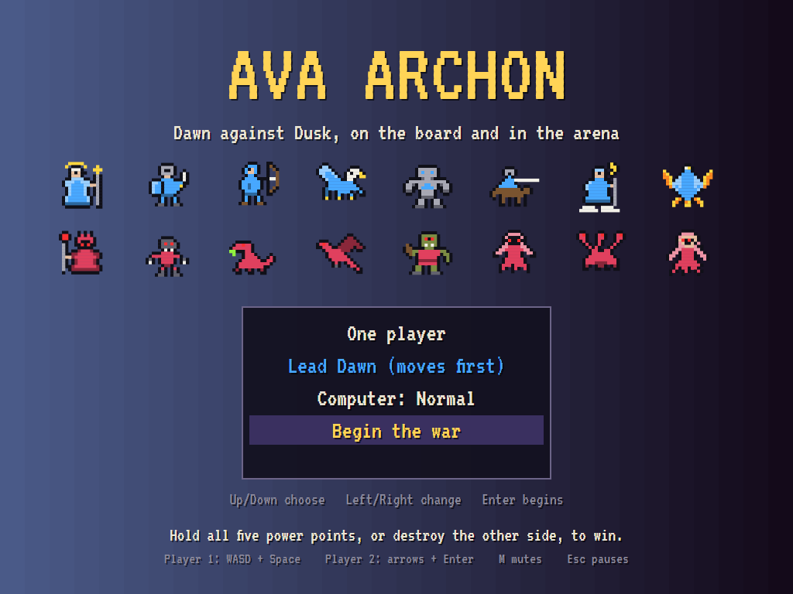
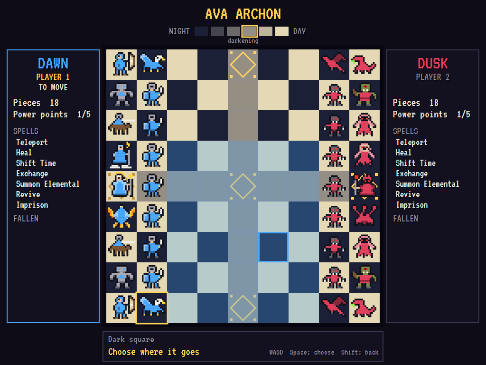
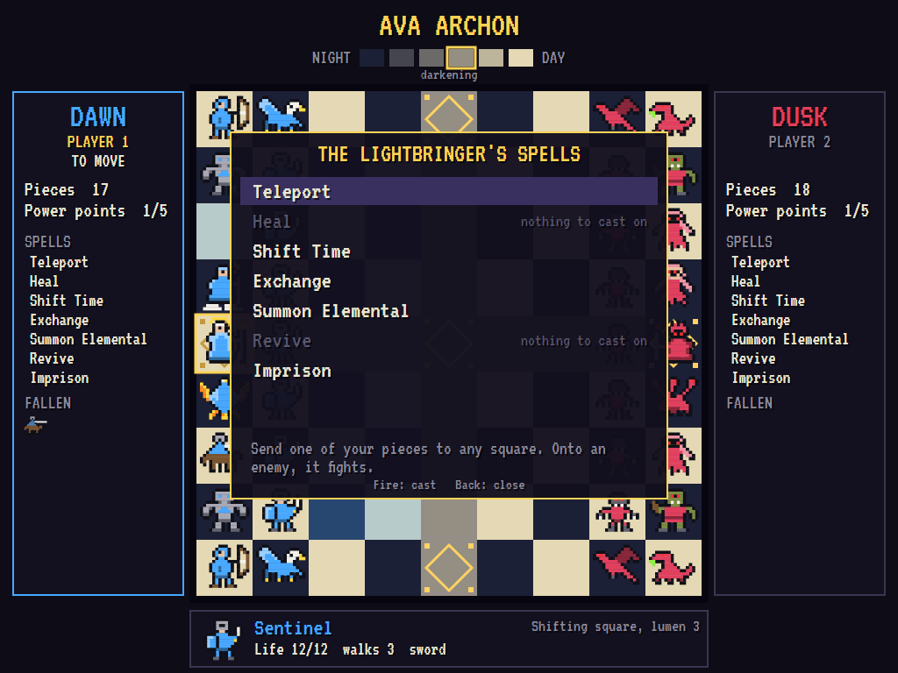
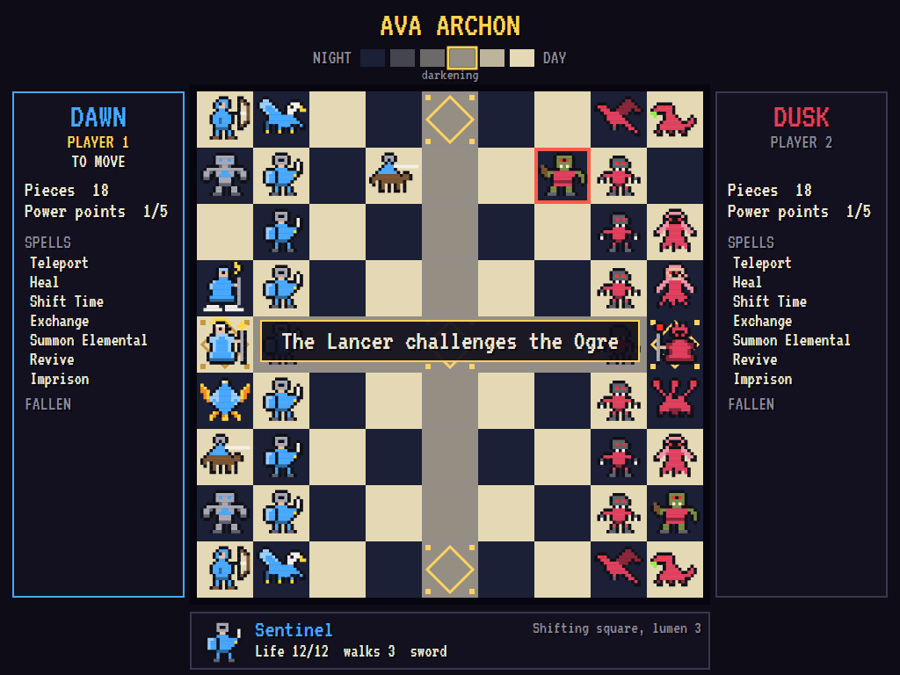
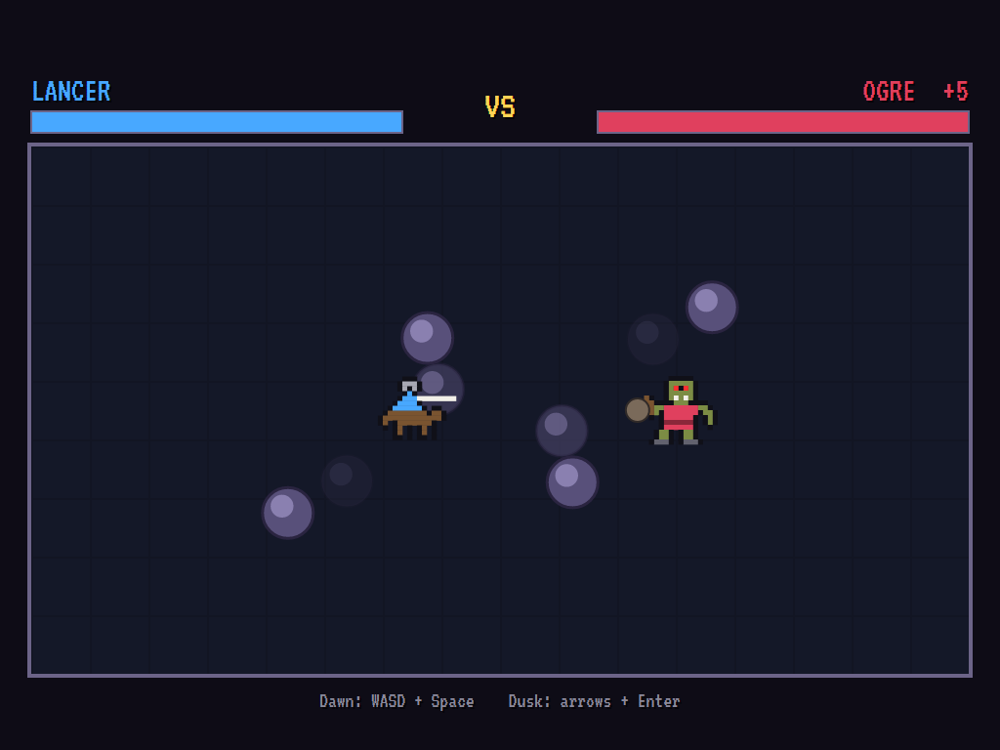
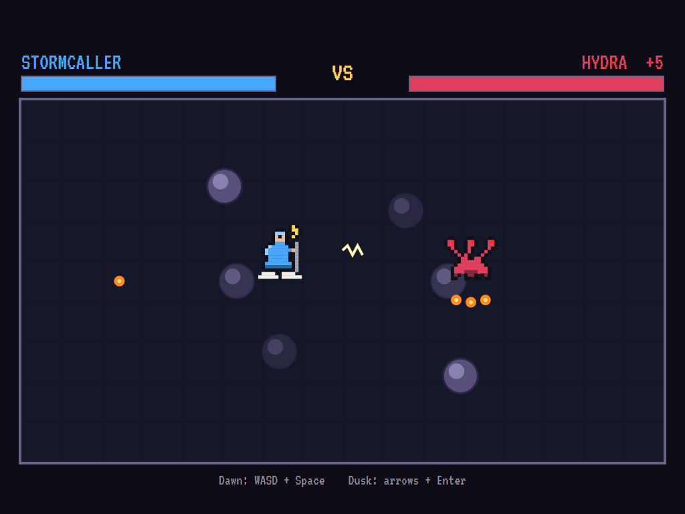
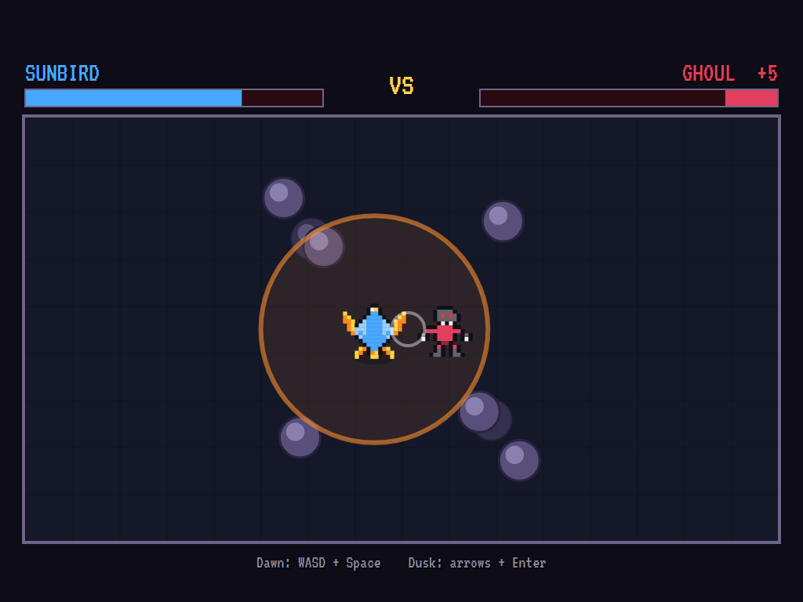
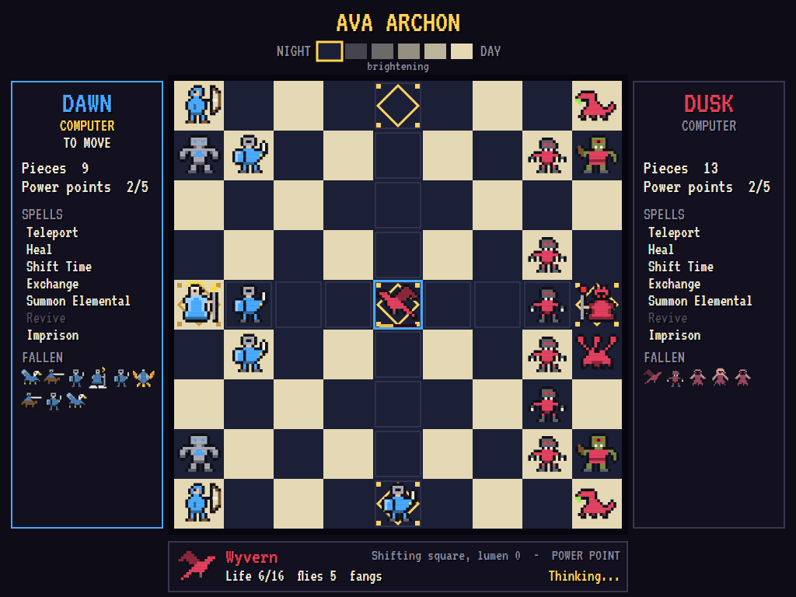
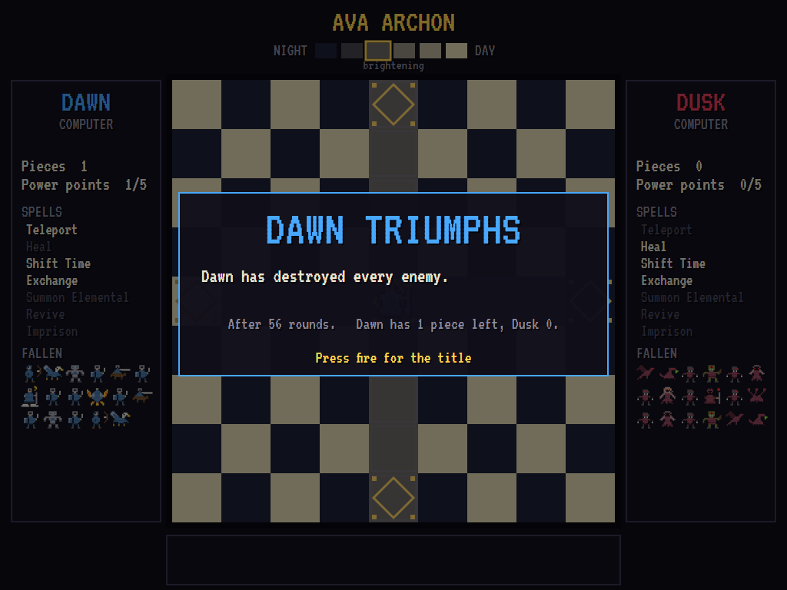

# AVAArchon

[](https://github.com/Harlock123/AVAArchon/actions/workflows/build.yml)

A strategy game with real-time battles, in the spirit of Free Fall Associates' 1983 classic
**Archon: The Light and the Dark**. It's built with .NET 10 and Avalonia UI. Two armies, **Dawn** and
**Dusk**, face each other across a 9 × 9 board, and every turn one piece moves. When a piece moves onto
an enemy, the board gives way to an arena, and the two fight it out in real time with swords,
arrows, lightning, flame and worse. The winner takes the square.

Play against the computer at one of three skills, or against a friend on the same keyboard. The
armies, pieces, spells and wording are original: this is the *style* of the classic, not its
contents.

## How the war is fought

1. **The board**: the squares are light, dark or shifting.
   - **The lumen**: the shifting squares brighten and darken as the lumen swings between night
     and day, one step each round.
   - **Home ground**: a Dawn piece fights with up to five extra life on a light square, and a Dusk
     piece on a dark one.
2. **Moving**: choose a piece, then where it goes.
   - **Walkers** step up to their move in any of eight directions, around other pieces.
   - **Fliers** go anywhere within their move, over anything in the way.
   - **Attacking**: moving onto an enemy starts a fight.
3. **The arena**: each champion moves and aims in eight directions and fires.
   - **Weapons**: some strike at close range, some throw or shoot, and some burst all around them
     (but can't move while they do).
   - **Pillars**: they breathe. Solid, they block walkers and missiles; fading, they let
     everything through.
   - **Afterwards**: whoever's life runs out loses the square. The survivor keeps its wounds and
     heals a little each turn.
4. **The power points**: five squares, glowing gold.
   - **Healing**: a piece on one heals fast.
   - **Protection**: spells can't touch it.
   - **Victory**: hold all five at once to win the war.
5. **The spells**: each side's leader has seven, and may cast each one once a game. Casting takes the
   leader's turn.

**Victory** goes to whoever holds all five power points, or destroys every enemy piece. If 150 turns
pass without a fight, the war ends in a truce.

## The armies

| Dawn | | Dusk | |
|---|---|---|---|
| **Lightbringer** (leader) | Flies 3; sunbolts; casts the spells | **Shadelord** (leader) | Flies 3; shadowbolts; casts the spells |
| **Sentinel** ×7 | Walks 3; sword | **Ghoul** ×7 | Walks 3; claws |
| **Archer** ×2 | Walks 3; quick arrows | **Spitter** ×2 | Walks 3; acid |
| **Gryphon** ×2 | Flies 5; talons | **Wyvern** ×2 | Flies 5; fangs |
| **Stonewarden** ×2 | Walks 3; hurled stones, very tough | **Ogre** ×2 | Walks 3; hurled rocks, very tough |
| **Lancer** ×2 | Walks 4; a long lance | **Wraith** ×2 | Flies 4; a chilling touch |
| **Stormcaller** | Flies 4; lightning | **Hydra** | Walks 3; three flames at once |
| **Sunbird** | Flies 5; a burst of flame | **Wailer** | Flies 4; a wounding wail |

The spells:

- **Teleport**: send one of your pieces to any square. Onto an enemy, it fights.
- **Heal**: heal one of your pieces of every wound.
- **Shift Time**: turn the lumen back the other way.
- **Exchange**: swap any two pieces.
- **Summon Elemental**: call an elemental to fight one enemy piece. It vanishes afterwards.
- **Revive**: bring back one of your fallen beside your leader.
- **Imprison**: hold an enemy piece where it stands for three of its turns.

## Features

- **Balanced armies**:
  - **The pieces**: no two are alike, though the armies mirror each other in strength. Across
    every pairing of Dawn piece against Dusk piece, each side wins about half the fights.
  - **The measurements**: the tests measure the pairings by having the computer fight every one of
    them.
- **A computer general**:
  - **On the board**: it judges each fight by those measured odds and the squares' strength. It
    takes and holds power points, and pulls threatened pieces back.
  - **Spells**: it casts them when they're worth more than a move.
  - **The longer the quiet**: the bolder it gets.
- **A computer fighter**: in the arena it lines up shots, keeps its distance or closes in as its
  weapon needs, and sidesteps missiles. Easy, Normal and Hard differ both on the board and in the
  arena.
- **Two players**: Dawn and Dusk each have their own keys (or gamepad). Dawn's player can't move
  Dusk's pieces, even by accident.
- **Sound**: a stately title march, a fanfare for the victor, and an effect for every weapon, step,
  spell and blow, all mixed by OpenAL.
- **Attract mode**: leave the title alone for 20 seconds and the computer plays both sides.
- **Gamepads** through SDL2, one per player, as well as the keyboard.
- **Any window size**: the screen scales to fit, letterboxed. **Ctrl+S** saves a screenshot.
- **One self-contained executable** per platform: Windows, macOS and Linux on Intel/AMD and ARM.

## Screenshots

| The title | The board | The spellbook |
|:---------:|:---------:|:-------------:|
|  |  |  |
| Choose your side. | A gryphon picked up, its flights lit. | The Lightbringer's seven spells. |

| The challenge | The arena | Lightning against fire |
|:-------------:|:---------:|:----------------------:|
|  |  |  |
| A lancer rides at an ogre. | Rocks against a lance, on a dark square. | The Stormcaller and the Hydra. |

| A burst of flame | The war goes on | Victory |
|:----------------:|:---------------:|:-------:|
|  |  |  |
| The Sunbird burns a ghoul. | Night falls on the shifting squares. | The last enemy falls. |

The tests make these screenshots by playing the game in a real (headless) window; see
[Tests](#tests).

## Download and run

The [Releases page](https://github.com/Harlock123/AVAArchon/releases/tag/latest) has ready-to-run builds
for Windows, macOS and Linux, on both Intel/AMD and ARM. **Latest build** is rebuilt on every push to
`main`. Each download is one self-contained executable, so there's no .NET to install.

| Platform | Archive |
|---|---|
| Windows | `AVAArchon-win-x64.zip`, `AVAArchon-win-x86.zip`, `AVAArchon-win-arm64.zip` |
| macOS | `AVAArchon-osx-arm64.tar.gz` (Apple silicon), `AVAArchon-osx-x64.tar.gz` (Intel) |
| Linux | `AVAArchon-linux-x64.tar.gz`, `AVAArchon-linux-arm64.tar.gz`, `AVAArchon-linux-arm.tar.gz` |

```bash
tar -xzf AVAArchon-linux-x64.tar.gz     # or linux-arm64, linux-arm, osx-arm64, osx-x64
./AVAArchon
```

On Windows, unzip the archive and run `AVAArchon.exe`. On macOS, if Gatekeeper refuses to open it,
run `xattr -d com.apple.quarantine AVAArchon` once. To play without sound, run it with `--no-audio`.

**Sound** comes through OpenAL Soft, which is built in for every platform. In a virtual machine the
game detects the VM and uses a larger audio buffer, so the sound doesn't break up.

**Gamepads** use SDL2, which is bundled for Windows, macOS and Intel/AMD Linux. ARM Linux builds need
SDL2 installed; without it, the keyboard still works:

```bash
sudo apt install libsdl2-dev            # Debian / Ubuntu / Raspberry Pi OS
sudo pacman -S --needed sdl2-compat     # Arch / Omarchy
```

## Controls

| | Player 1 (Dawn in a two-player game) | Player 2 (Dusk) |
|---|---|---|
| Move the cursor, or the champion | **W A S D** | **Arrow keys** |
| Fire: choose, cast, attack | **Space** / **Left Ctrl** / **Z** | **Enter** / **Right Ctrl** |
| Back: put a piece down, close the spellbook | **Left Shift** / **X** / **Q** | **Right Shift** / **Backspace** |
| Gamepad | the first: stick or D-pad, A to fire, B to go back | the second |

Playing alone, either set of keys works. To open the spellbook, choose your leader, then choose it
again.

| Anywhere | |
|---|---|
| **Enter** on the title | Begin |
| **P** / **Esc** | Pause (Esc again for the title) |
| **M** / **F2** | Mute |
| **Ctrl+S** / **Cmd+S** | Save a screenshot to the Pictures folder |

## Tests

```bash
dotnet test AVAArchon.slnx
```

The engine has no UI and runs in fixed 60 Hz steps, so a seed always plays the same game. The tests
check:

- **The board**:
  - **The armies**: how they're drawn up.
  - **Squares and lumen**: what light and dark give each side, and how the lumen swings.
  - **Movement**: walkers going round pieces while fliers pass over.
- **Turns**:
  - **Two players**: each moves with their own controls, and can't move the other's pieces.
  - **Picking**: putting a piece back down; a blocked piece can't be picked.
- **Fights**:
  - **The challenge**: a piece moving onto an enemy, and the winner holding the square.
  - **The arena**: blows landing only within reach, solid pillars stopping missiles, and a burst
    rooting its maker.
  - **Wounds**: they last, but heal, fastest on a power point.
- **Spells**: every one of the seven, cast once each and never on a piece on a power point. The
  tests include an elemental fighting for its caller, and an imprisoned piece waiting out its
  sentence.
- **Winning**: holding all five power points, destroying every enemy, and the truce.
- **The computer**:
  - **Judgement**: taking a fight it will win, and shunning one it will lose.
  - **Skill**: Hard beats Easy, both in the arena and over a whole war.
  - **Whole wars**: played to a finish.
- **The machine**:
  - **The title**: it sets up the game and idles into a demonstration.
  - **Assets**: every piece has a picture and every sound a file.
  - **Odds**: there are measured odds for every pairing.

The screenshot tests draw the real screen in a headless window. To refresh the README's pictures:

```bash
ARCHON_SHOTS=$PWD/Images dotnet test tests/AVAArchon.Tests --filter ScreenshotTests
```

After changing any piece's numbers, measure the odds afresh (the computer judges fights by them):

```bash
ARCHON_ODDS=1 dotnet test tests/AVAArchon.Tests --filter OddsTableTests.Measure
```

## Building

```bash
dotnet build AVAArchon.slnx
dotnet run --project src/AVAArchon
```

You'll need the .NET 10 SDK. `tools/make_sounds.py` makes the sounds and needs only standard-library
Python: `python3 tools/make_sounds.py` rewrites `src/AVAArchon/Sounds`.

## Project structure

```
AVAArchon/
├── AVAArchon.slnx
├── src/AVAArchon/
│   ├── Engine/
│   │   ├── Pieces.cs              # The two armies' pieces: moves, life, weapons
│   │   ├── Board.cs               # Squares, the lumen, power points, moves, healing
│   │   ├── Arena.cs               # The real-time fight: fighters, missiles, breathing pillars
│   │   ├── Brain.cs               # The computer's hands in the arena
│   │   ├── Computer.cs            # The computer's general: moves and spells
│   │   ├── OddsTable.cs           # Measured odds of every pairing (generated by the tests)
│   │   ├── Spells.cs              # The leaders' seven spells and whom they may touch
│   │   ├── GameEngine.cs          # States, the title, players and controls
│   │   ├── GameEngine.Turn.cs     # A turn: picking, moving, casting, fighting, winning
│   │   ├── InputHandler.cs, ControllerManager.cs  # Two players' keys and SDL2 gamepads
│   │   └── SoundManager.cs        # Effects and tunes through OpenAL
│   ├── Audio/                     # The OpenAL engine (from the author's AVABand)
│   ├── Views/                     # The board, the arena, the title, and the pictures
│   └── Sounds/                    # The synthesised effects and tunes
├── tests/AVAArchon.Tests/         # Gameplay, odds and screenshot tests
├── tools/make_sounds.py
└── Images/                        # Screenshots
```

## About and licence

AVAArchon © 2026 Lonnie Watson, under the [MIT License](LICENSE).

*Archon: The Light and the Dark* © 1983 Free Fall Associates and Electronic Arts. The name belongs to
its current owner. AVAArchon is an independent, unofficial game in its style. Its armies, pieces,
spells, board, graphics, sounds, tunes and code are its own, and nothing is taken from that game. No
rights holder is affiliated with or endorses it.
